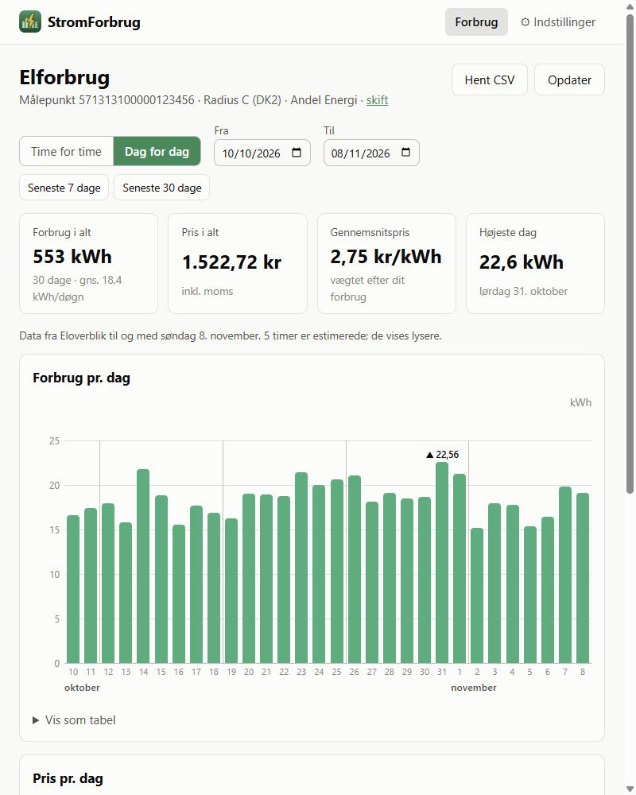
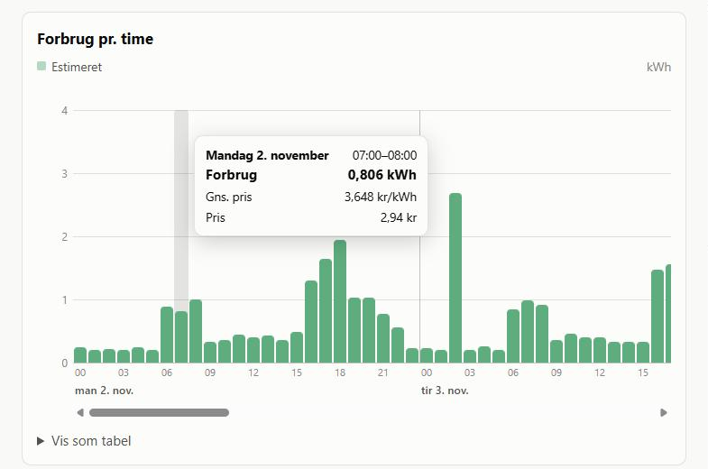
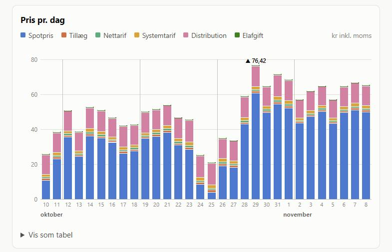

<p align="center">
  
</p>

<h1 align="center">El Forbrug</h1>

<p align="center">
  <b>What did your electricity actually cost – hour by hour?</b><br>
  Your consumption from Eloverblik, priced with everything on the bill.
</p>

<p align="center">
  <a href="https://kreaton.github.io/ElForbrug/"></a>
</p>

<p align="center">
  <a href="https://github.com/kreaton/ElForbrug/actions/workflows/deploy-web.yml"></a>
  
  
  <a href="LICENSE"></a>
  <a href="https://github.com/kreaton/ElForbrug/stargazers"></a>
</p>

<p align="center">⭐ If El Forbrug earns a place on your machine, <a href="https://github.com/kreaton/ElForbrug">star it on GitHub</a> — it's free, made by one developer, and stars are how other people find it.</p>

<p align="center">
  
</p>

See how much electricity your household has used – **hour by hour for the past week**, or
**day by day for the past month** – and what it cost. The price is everything on the bill: the
spot price, your electricity company's surcharge, the grid company's tariffs and the electricity
tax. Each hour is priced on its own, so you can see what it costs to charge the car at 18 instead
of at 02.

The consumption comes from [Eloverblik](https://eloverblik.dk), the prices from
[stromligning.dk](https://stromligning.dk). The app is in Danish. El Forbrug is the sibling of
[El Forecast](https://github.com/kreaton/ElForecast), which looks at prices *ahead*.

> The screenshots show made-up demo consumption with real prices for Radius (DK2) and Andel Energi.

## Using it

Open **<https://kreaton.github.io/ElForbrug/>** in a browser – nothing to install. It can be added
to the home screen of a phone. It shows bar charts of kWh and kroner, and tables.

Your token is kept in your browser. It is sent to Eloverblik through a small relay on hejndorf.dk,
which stores nothing ([why](#why-the-web-app-needs-a-php-relay)).

## Getting started

You need a token from Eloverblik – it is free and takes a minute:

1. Log in to [eloverblik.dk](https://eloverblik.dk) with MitID, choose **Datadeling** and
   **Opret token**. Copy the token. It lasts up to a year.
2. Open El Forbrug. The first time, **Indstillinger** opens by itself. Paste the token and press
   **Hent målepunkter** – your consumption point is picked automatically.
3. Choose your **netselskab** (the grid company, printed on your bill), **kundegruppe**,
   **elhandelsselskab** and **produkt**. They decide the tariffs and the surcharge. Leave the grid
   company empty to see kWh only.
4. Tick **Vis kroner inkl. moms** to see what you actually paid, and press **Gem og vis forbrug**.

## Reading it

<p align="center">
  
</p>

- **Time for time / Dag for dag** switches between one bar per hour (default: the past 7 days)
  and one bar per day (default: the past 30 days). **Fra** and **Til** pick any period of up to
  30 days. Eloverblik's data normally reaches yesterday, sometimes a day or two less.
- **Forbrug** shows kWh. Hours that Eloverblik marks as estimated, and days that are mostly
  estimated, are drawn lighter. Point at a bar to see its kWh, price and cost.
- **Pris** shows kroner, stacked by what the price is made of. Each hour's cost is that hour's kWh
  times that hour's price, so a day's total reflects *when* you used the power, not the day's
  average price. Subscriptions and other fixed fees are not included.

<p align="center">
  
</p>

- The boxes give the total kWh, the total cost, the average price you paid per kWh (weighted by
  your consumption) and the highest hour or day.
- **Vis som tabel** shows the numbers, and **Hent CSV** saves them in a
  format that opens straight into columns in a Danish Excel.

## For developers

| Project | |
|---|---|
| `Eloverblik` | Class library for the Eloverblik customer API: token exchange (cached and renewed, with a hook to persist it), metering points, and meter data parsed into `MeterReading`s. Talks to Eloverblik directly or through a relay. |
| `Stromligning` | Copy of the library from ElForecast, plus an optional `aggregation` ("1h") on `GetPricesAsync`. |
| `ElForbrug.Core` | `ConsumptionService` fetches both and multiplies them hour by hour (`ConsumptionRow`, `Cost`, daily totals, `Slice`, CSV export). Danish time via `DanishTime`. |
| `ElForbrug.Web` | The Blazor WebAssembly app. Strømligning is called directly; Eloverblik through the PHP relay `wwwroot/api/eloverblik.php`. |

```powershell
tools/run-dev.ps1                           # PHP relay on :5290 + web app on http://localhost:5286
```

### Builds

| Workflow | Runs on pushes to `main` that touch | Publishes |
|---|---|---|
| [`deploy-web.yml`](.github/workflows/deploy-web.yml) | the web app and the libraries | The app to [GitHub Pages](https://kreaton.github.io/ElForbrug/), and the PHP relay by FTP to hejndorf.dk/stromforbrug/api/ (with a page there that sends old links on to Pages) |

The FTP job needs the repository secrets `FTP_HOST`, `FTP_USERNAME`, `FTP_PASSWORD` and
`FTP_FOLDER`. The icons are drawn by `tools/make-icons.ps1`.

### Why the web app needs a PHP relay

A browser only lets a page read another site's answer if the answer carries an
`Access-Control-Allow-Origin` header. Eloverblik's *error* answers have it, its *successful* ones
don't, so the browser throws away the access token and the app sees only `TypeError: Failed to
fetch`.

So the web app sends its Eloverblik calls to `api/eloverblik.php`, which passes
them on to `api.eloverblik.dk` and returns the answer. It relays only the three endpoints the app
uses (token, metering points, time series), stores and logs nothing, and needs PHP 8 with the curl
extension. Many Apache/PHP hosts (hejndorf.dk among them) drop the `Authorization` header before
PHP sees it, so through a relay the app repeats the token in `X-Eloverblik-Authorization`.

- **Hosting:** the relay needs a host that runs PHP, which GitHub Pages cannot. The app is served
  from Pages and calls the relay on hejndorf.dk (`EloverblikRelay` in `wwwroot/appsettings.json`),
  which lets pages from `https://kreaton.github.io` read its answers. Without that setting the app
  uses `api/eloverblik.php` on its own site.
- **Development:** the Blazor dev server does not run PHP. `tools/run-dev.ps1` starts PHP's built-in
  server on port 5290 for the relay, and `wwwroot/appsettings.Development.json` (not published)
  points the app there. The relay lets `localhost` pages read its answers too.

### Notes on the Eloverblik API

- `GET /customerapi/api/token` with the refresh token as bearer returns `{ "result": "<access token>" }`,
  valid 24 hours. The token endpoint is rate limited, so the apps keep the access token between runs.
- `POST /customerapi/api/meterdata/gettimeseries/{from}/{to}/Hour` with
  `{ "meteringPoints": { "meteringPoint": ["<id>"] } }`. Dates are Danish calendar days, `to` exclusive.
  Each `Period` starts at a UTC instant and its `Point`s are 1-based positions of one `resolution`.
- A 200 answer can still carry a per-point error (`success: false`, `errorText`), which becomes an
  `EloverblikApiException`. 429 and 503 mean "try again later" (`IsBusy`), 401 on the token call
  means the refresh token is wrong or expired (`IsUnauthorized`).

## License & Authorship

This project is distributed under the terms of the [MIT License](LICENSE).

Consumption data from [Eloverblik](https://eloverblik.dk), price data from [stromligning.dk](https://stromligning.dk).

**AI authorship note:** Most of the source code in this repository was generated with AI coding agents (Claude Code), under my direction and review. Purely AI-generated material may not be eligible for copyright protection in some jurisdictions. To the extent any part of this project is protected by copyright, it is licensed under the MIT License, and the license's warranty and liability disclaimers apply to the project as a whole.

<!-- notices:start -->
### Independent development

El Forbrug is an independent, personal project developed by Per Hejndorf. It is not affiliated with, endorsed by or sponsored by Microsoft or any other rights holder (including Energinet or Strømligning). Product names and logos are trademarks of their respective owners and are used only to identify the services and tools the project works with.

### Third-party notices and asset provenance

[THIRD-PARTY-NOTICES.md](THIRD-PARTY-NOTICES.md) lists every third-party library, font and online service the project uses, with version, licence, source and whether it was modified. It also records where the icons, images, audio and video came from and how they are licensed. A few assets are not covered by the MIT License; [THIRD-PARTY-NOTICES.md](THIRD-PARTY-NOTICES.md) marks them and states their terms.
<!-- notices:end -->
