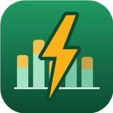
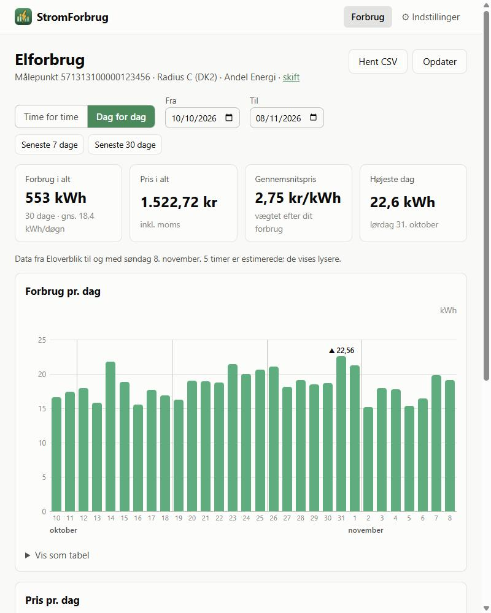
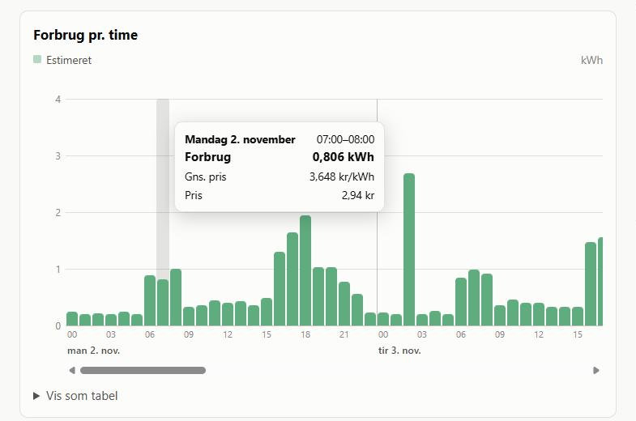
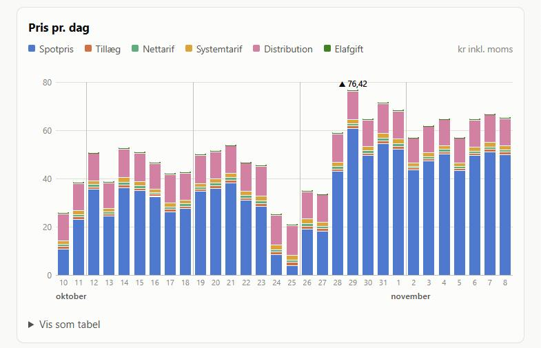

<p align="center">
  
</p>

<h1 align="center">StromForbrug</h1>

<p align="center">
  <b>What did your electricity actually cost – hour by hour?</b><br>
  Your consumption from Eloverblik, priced with everything on the bill.
</p>

<p align="center">
  <a href="https://hejndorf.dk/stromforbrug/"></a>
  <a href="https://github.com/kreaton/StromForbrug/releases/latest"></a>
</p>

<p align="center">
  <a href="https://github.com/kreaton/StromForbrug/actions/workflows/deploy-web.yml"></a>
  <a href="https://github.com/kreaton/StromForbrug/actions/workflows/release-windows.yml"></a>
  
  
  <a href="LICENSE"></a>
</p>

<p align="center">
  
</p>

See how much electricity your household has used – **hour by hour for the past week**, or
**day by day for the past month** – and what it cost. The price is everything on the bill: the
spot price, your electricity company's surcharge, the grid company's tariffs and the electricity
tax. Each hour is priced on its own, so you can see what it costs to charge the car at 18 instead
of at 02.

The consumption comes from [Eloverblik](https://eloverblik.dk), the prices from
[stromligning.dk](https://stromligning.dk). The apps are in Danish. StromForbrug is the sibling of
[StromPriser](https://github.com/kreaton/StromPriser), which looks at prices *ahead*.

> The screenshots show made-up demo consumption with real prices for Radius (DK2) and Andel Energi.

## Two ways to use it

| | 🌐 **In the browser** | 🪟 **On Windows** |
|---|---|---|
| Get it | Open **<https://hejndorf.dk/stromforbrug/>** – nothing to install. It can be added to the home screen of a phone. | Download **[StromForbrug-win-Setup.exe](https://github.com/kreaton/StromForbrug/releases/latest/download/StromForbrug-win-Setup.exe)** from the [latest release](https://github.com/kreaton/StromForbrug/releases/latest). It installs the .NET 10 runtime if needed, and updates itself with **Søg efter opdatering**. |
| Shows | Bar charts of kWh and kroner, and tables | The same charts, plus one table with every price component |
| Your token | Kept in your browser. It is sent to Eloverblik through the site's small relay, which stores nothing ([why](#why-the-web-app-needs-a-php-relay)). | Encrypted for your Windows user in `%APPDATA%\StromForbrug\settings.json` |

A portable zip (no installer) is attached to every release as well.

## Getting started

You need a token from Eloverblik – it is free and takes a minute:

1. Log in to [eloverblik.dk](https://eloverblik.dk) with MitID, choose **Datadeling** and
   **Opret token**. Copy the token. It lasts up to a year.
2. Open StromForbrug. The first time, **Indstillinger** opens by itself. Paste the token and press
   **Hent målepunkter** – your consumption point is picked automatically.
3. Choose your **netselskab** (the grid company, printed on your bill), **kundegruppe**,
   **elhandelsselskab** and **produkt**. They decide the tariffs and the surcharge. Leave the grid
   company empty to see kWh only.
4. Tick **Vis kroner inkl. moms** to see what you actually paid, and press **Gem og vis forbrug**.

## Reading it

<p align="center">
  
</p>

- **Time for time / Dag for dag** switches between one bar per hour (default: the past 7 days)
  and one bar per day (default: the past 30 days). **Fra** and **Til** pick any period of up to
  30 days. Eloverblik's data normally reaches yesterday, sometimes a day or two less.
- **Forbrug** shows kWh. Hours that Eloverblik marks as estimated, and days that are mostly
  estimated, are drawn lighter. Point at a bar to see its kWh, price and cost.
- **Pris** shows kroner, stacked by what the price is made of. Each hour's cost is that hour's kWh
  times that hour's price, so a day's total reflects *when* you used the power, not the day's
  average price. Subscriptions and other fixed fees are not included.

<p align="center">
  
</p>

- The boxes give the total kWh, the total cost, the average price you paid per kWh (weighted by
  your consumption) and the highest hour or day.
- **Vis som tabel** shows the numbers, and **Hent CSV** / **Gem som CSV...** saves them in a
  format that opens straight into columns in a Danish Excel.

## For developers

| Project | |
|---|---|
| `Eloverblik` | Class library for the Eloverblik customer API: token exchange (cached and renewed, with a hook to persist it), metering points, and meter data parsed into `MeterReading`s. Talks to Eloverblik directly or through a relay. |
| `Stromligning` | Copy of the library from StromPriser, plus an optional `aggregation` ("1h") on `GetPricesAsync`. |
| `StromForbrug.Core` | `ConsumptionService` fetches both and multiplies them hour by hour (`ConsumptionRow`, `Cost`, daily totals, `Slice`, CSV export). Danish time via `DanishTime`. |
| `StromForbrug.Web` | The Blazor WebAssembly app. Strømligning is called directly; Eloverblik through the PHP relay `wwwroot/api/eloverblik.php`. |
| `StromForbrug.Windows` | The Windows Forms app (`StromForbrug.exe`) with a small self-drawn bar chart, installed and updated with [Velopack](https://velopack.io). |

```powershell
tools/run-dev.ps1                           # PHP relay on :5290 + web app on http://localhost:5286
dotnet run --project StromForbrug.Windows   # Windows only
tools/BuildRelease.ps1 -LocalOnly           # Velopack packages in .\Releases, nothing uploaded
```

### Builds and releases

| Workflow | Runs on pushes to `main` that touch | Publishes |
|---|---|---|
| [`deploy-web.yml`](.github/workflows/deploy-web.yml) | the web app and the libraries | The site with the relay by FTP to [hejndorf.dk/stromforbrug](https://hejndorf.dk/stromforbrug/), and to [GitHub Pages](https://kreaton.github.io/StromForbrug/) (prices only – Pages cannot run PHP) |
| [`release-windows.yml`](.github/workflows/release-windows.yml) | the Windows app and the libraries | A [GitHub release](https://github.com/kreaton/StromForbrug/releases) with Setup.exe, a portable zip and Velopack update packages, numbered on from the last release (1.0.*n*) |

The FTP job needs the repository secrets `FTP_HOST`, `FTP_USERNAME`, `FTP_PASSWORD` and
`FTP_FOLDER`. The icons are drawn by `tools/make-icons.ps1`.

### Why the web app needs a PHP relay

A browser only lets a page read another site's answer if the answer carries an
`Access-Control-Allow-Origin` header. Eloverblik's *error* answers have it, its *successful* ones
don't, so the browser throws away the access token and the app sees only `TypeError: Failed to
fetch`. The Windows app is not affected: the rule exists only in browsers.

So the web app sends its Eloverblik calls to `api/eloverblik.php` on its own site, which passes
them on to `api.eloverblik.dk` and returns the answer. It relays only the three endpoints the app
uses (token, metering points, time series), stores and logs nothing, and needs PHP 8 with the curl
extension. Many Apache/PHP hosts (hejndorf.dk among them) drop the `Authorization` header before
PHP sees it, so through a relay the app repeats the token in `X-Eloverblik-Authorization`.

- **Hosting:** the site must run PHP. On a static host such as GitHub Pages the app loads and shows
  prices, but says it cannot reach Eloverblik.
- **Development:** the Blazor dev server does not run PHP. `tools/run-dev.ps1` starts PHP's built-in
  server on port 5290 for the relay, and `wwwroot/appsettings.Development.json` (not published)
  points the app there. The relay lets `localhost` pages read its answers for this purpose.

### Notes on the Eloverblik API

- `GET /customerapi/api/token` with the refresh token as bearer returns `{ "result": "<access token>" }`,
  valid 24 hours. The token endpoint is rate limited, so the apps keep the access token between runs.
- `POST /customerapi/api/meterdata/gettimeseries/{from}/{to}/Hour` with
  `{ "meteringPoints": { "meteringPoint": ["<id>"] } }`. Dates are Danish calendar days, `to` exclusive.
  Each `Period` starts at a UTC instant and its `Point`s are 1-based positions of one `resolution`.
- A 200 answer can still carry a per-point error (`success: false`, `errorText`), which becomes an
  `EloverblikApiException`. 429 and 503 mean "try again later" (`IsBusy`), 401 on the token call
  means the refresh token is wrong or expired (`IsUnauthorized`).

## License

[MIT](LICENSE) © 2026 Per Hejndorf. Consumption data from [Eloverblik](https://eloverblik.dk),
price data from [stromligning.dk](https://stromligning.dk).
